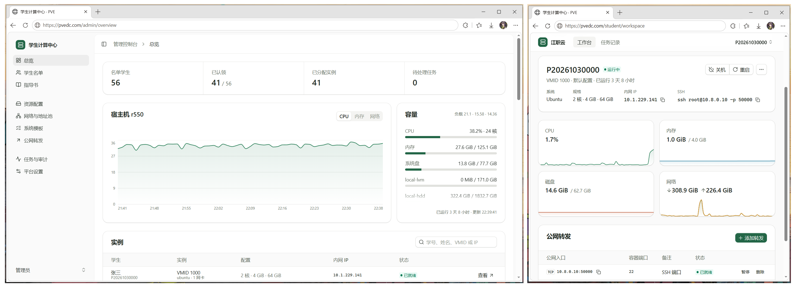
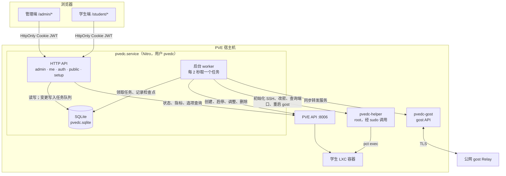
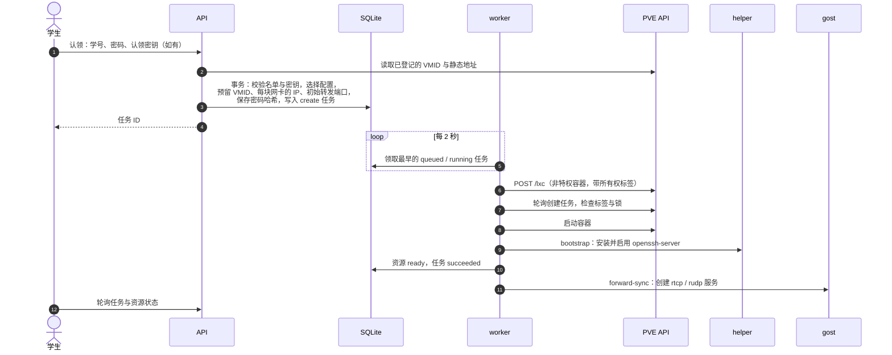
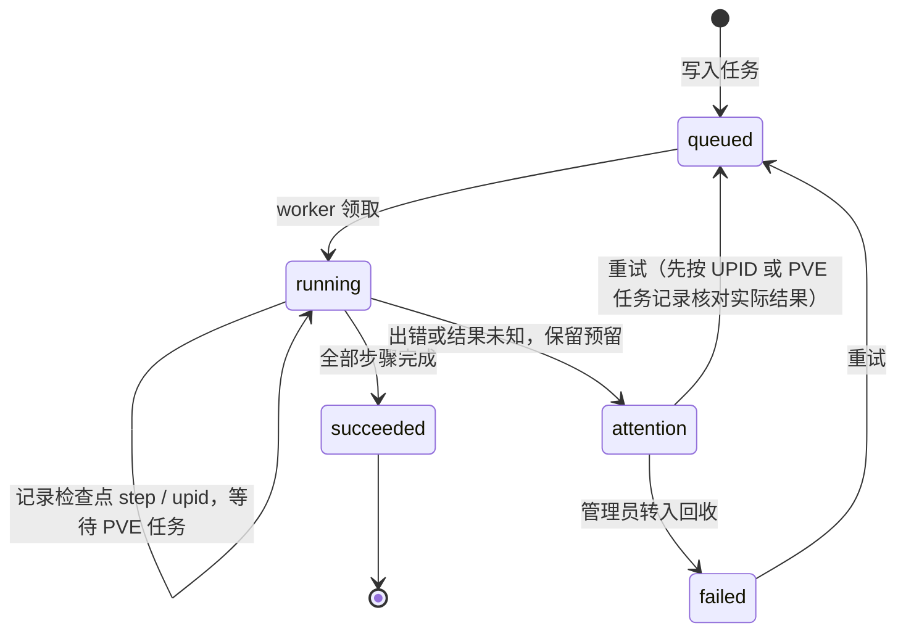
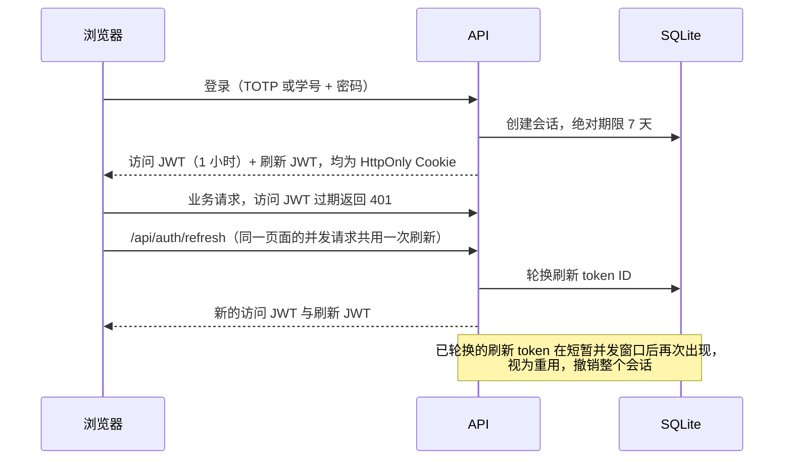

# PVE Distribution Center · 学生计算中心

在单台 Proxmox VE 主机上运行的 LXC 自助分配平台。毕业设计和专业课程实践常要给几十上百名学生各分一台 Linux 环境，手工创建、分发和维护效率很低。使用本平台，管理员维护名单、资源规格、网络和公网转发，学生认领学号后即可得到一台带固定 IP、SSH 和公网端口的容器。



## 功能

- **登录**：管理员使用 TOTP，首次访问显示文本密钥和二维码；学生使用学号和密码。访问 JWT 一小时有效，刷新 JWT 每次轮换，登录最长七天。
- **名单**：CSV 或表格粘贴导入、导出；按搜索结果批量启动、关机、重启、回收、删除。可为学生指定资源配置或设置认领密钥，未设置密钥时认领无需填写。
- **资源配置**：多套规格、默认配置，以及由管理员开关的学生自选模式；可声明创建后自动建立的 TCP/UDP 转发。
- **容器**：PVE 原生非特权 LXC，主机名为学号，Ubuntu / Debian，静态 IPv4，自动启用 SSH。
- **网络**：NAT（SDN Simple + SNAT）或已有网桥；一套配置可绑定多个网络。IP 和 VMID 在事务中预留，容量估算只作参考。
- **监控**：宿主机与每台容器的 CPU、内存、磁盘、流量及一小时趋势，容器内 TCP/UDP 监听端口。
- **操作**：启停、重启、同步修改 root 密码、按原配置原 IP 重建；管理员可回收容器、调整规格与网卡。
- **公网转发**：通过 gost v3 Relay + TLS 反向转发，公网端口自动分配或手动指定，受端口池和配额约束。
- **指导书**：Milkdown 编辑，支持 `{{machine.ip}}`、`{{forward:22}}` 等占位符，按学生渲染。
- **任务与审计**：变更操作进入持久化任务队列，失败可重试，服务重启后从检查点恢复；审计日志服务端分页查询。

## 部署到 PVE

目前只在 PVE 9.2（Debian 13，amd64）上验证过。`better-sqlite3` 与 `argon2` 含平台相关的原生模块，安装脚本会在 PVE 上安装依赖并构建，不要把 Windows 或 macOS 上构建的 `.output/` 复制到 Linux。

### 安装

把项目下载或 clone 到 `/opt/pvedc`（安装脚本会检查这个路径），以 root 执行：

```bash
bash /opt/pvedc/deploy/install.sh
```

安装脚本运行流程：

1. 用临时源列表从 Debian 官方源安装 `curl`、`python3`、`sudo`、`make`、`g++` 等依赖，不改动现有的 PVE 企业 / 非订阅源。
2. 下载 Node.js 24.21.0 到 `/opt/pvedc-runtime`、gost 3.3.0 到 `/usr/local/bin/pvedc-gost`，校验 SHA-256；全局安装 pnpm 10.33.2。
3. 创建 `pvedc` 系统用户；安装 root 所有的 `/usr/local/libexec/pvedc-helper`，sudoers 只允许 `pvedc` 执行这一个程序。
4. 运行 `deploy/bootstrap.py`：创建 `DistributionCenter` 角色、`pvedc@pve` 用户和 `web` API Token，读取本机 PVE CA，生成 `/etc/pvedc/bootstrap.json`、`runtime.env`、`instance-id` 和 gost 初始配置。凭据只写入文件，不打印到终端。
5. 以 `pvedc` 身份执行 `pnpm install --frozen-lockfile` 和 `pnpm build`，安装并启动 `pvedc.service`、`pvedc-gost.service`。

安装脚本可以重复执行，已有的 API Token、gost 配置、`runtime.env` 和实例 ID 都会保留。迁移和更新项目**推荐使用迁移脚本**，不带参数运行可查看用法：

```bash
bash /opt/pvedc/deploy/migrate.sh
```

### 首次配置

安装完成后访问 `http://<PVE-IP>:3000`，完成 TOTP 绑定（密钥只在绑定阶段显示），再按顺序配置：

1. **平台设置**：核对 PVE API 连接与容量保留额度。
2. **系统模板**：下载 Ubuntu 或 Debian 模板。
3. **网络与地址池**：新建 NAT 或桥接网络，保存后点击“应用网络”。
   - 桥接网络的地址池必须是网络管理员允许使用、不会被 DHCP 分配给其他设备的地址段；
   - 平台只能避开自己分配的地址和 PVE 中已登记的静态地址，无法发现校园网里未登记的设备。
4. **资源配置**：选择模板、存储、规格和网络，发布并设为默认。
5. **学生名单**：导入名单，按需为学生指定配置或设置认领密钥。
6. **平台设置**：开放认领，按需开启学生自选配置。
7. **公网转发**：填写 Relay 与 TLS 参数，点击“应用 gost 配置”。

如果 API Token 启用了权限分离（privsep），除了用户本身的授权，还要给 Token 单独授予 `DistributionCenter` 角色，否则宿主指标会返回 403、资源选项为空：

```bash
pveum acl modify / -tokens 'pvedc@pve!web' -roles DistributionCenter
```

### 公网访问

平台运行在校园内网的 PVE 宿主机上。要让校外访问 Web 页面和容器，需要一台公网服务器运行 gost v3 Relay 服务，把内网服务远程转发到公网对应端口。


**1. 生成自签证书。** `CN` 和 `subjectAltName` 中的名称就是平台里要填写的“TLS 服务名”，下面以 `relay.example.edu` 为例。证书必须带 `subjectAltName`，gost 不接受只有 `CN` 的证书：

```bash
mkdir -p /etc/gost/certs
```

```bash
openssl req -x509 -newkey rsa:2048 -nodes -days 365 -keyout /etc/gost/certs/key.pem -out /etc/gost/certs/cert.pem -subj "/CN=relay.example.edu" -addext "subjectAltName=DNS:relay.example.edu"
```

**2. 安装 [gost v3](https://gost.run/) 并启动 Relay。** 以监听 10000 端口为例，`<USERNAME>`、`<PASSWORD>` 替换为自己设定的 Relay 认证信息：

```bash
gost -L "relay+tls://<USERNAME>:<PASSWORD>@:10000?bind=true&certFile=/etc/gost/certs/cert.pem&keyFile=/etc/gost/certs/key.pem"
```

**3. 在平台“公网转发”页填写参数**，保存后点击“应用 gost 配置”生效：

| 字段 | 填写内容 |
| --- | --- |
| Relay 主机 / Relay 端口 | 公网服务器地址和上面的监听端口（例如 `10000`；平台默认值是 `8443`，需要改成一致） |
| Relay 用户名 / Relay 密码 | 上面命令中的 `<USERNAME>`、`<PASSWORD>` |
| TLS 服务名 | 证书中的名称，例如 `relay.example.edu` |
| 自定义 CA 证书 PEM | `/etc/gost/certs/cert.pem` 的内容 |
| 学生使用的公网主机名 | 学生连接转发端口时使用的公网 IP 或域名 |
| 端口池起始值 / 结束值 | 分配给学生转发的公网端口范围 |
| Relay 上的 Web 绑定地址 | 默认 `127.0.0.1`，只有 Relay 服务器本机能访问，需要在该服务器上配置反向代理；改为 `0.0.0.0` 后可直接通过“公网 IP:Web 通道端口”访问（HTTP，未加密） |
| 公网 Web 通道端口 | Web 页面在 Relay 服务器上的端口，默认 `18081` |

**4. 放行公网服务器防火墙或安全组**：Relay 监听端口、Web 通道端口（直接对外访问时），以及学生端口池的 TCP 和 UDP。修改平台中的端口池不会自动修改公网服务器的防火墙、安全组或 Docker 端口映射。

## 环境变量

所有变量都可省略：安装脚本会写好生产环境需要的值，业务配置可在 Web 页面完成。变量分两类：**运行时变量**每次启动都会读取；**初始化变量**只在数据库还没有对应数据时读取一次，之后以 Web 中保存的配置为准，再修改环境变量不会覆盖。

### 运行时变量

| 变量 | 说明 | 默认值 | 生产环境取值 |
| --- | --- | --- | --- |
| `HOST` | 监听地址 | Nitro 默认 | `0.0.0.0`（`pvedc.service`） |
| `PORT` | 监听端口 | `3000` | `3000`（`pvedc.service`） |
| `NODE_ENV` | 运行模式 | — | `production` |
| `PDC_DATA_DIR` | 数据目录，存放数据库、主密钥和 gost 配置 | `.data` | `/var/lib/pvedc` |
| `PDC_BOOTSTRAP_FILE` | 安装脚本生成的 PVE / gost 连接参数 JSON | — | `/etc/pvedc/bootstrap.json` |
| `PDC_HELPER_PATH` | root helper 路径。sudoers 只放行默认路径，生产环境不要修改 | `/usr/local/libexec/pvedc-helper` | 默认值 |

### 初始化变量

| 变量 | 说明 | 生效时机 |
| --- | --- | --- |
| `PDC_INSTANCE_ID` | 安装实例 ID，用于生成容器所有权标签 `pvedc-<id>`。安装脚本写入 `runtime.env` | 数据库首次创建；省略时随机生成 |
| `PDC_MASTER_KEY` | Base64 编码的 32 字节主密钥 | `master.key` 不存在时；省略时随机生成 |
| `PDC_TOTP_SECRET` | Base32 管理员 TOTP 密钥 | 尚未绑定 TOTP 时；省略时在 `/setup` 页面生成 |
| `PDC_INITIAL_SETTINGS` | 业务设置 JSON，字段见 `shared/schema.ts` 的 `settingsSchema` | 设置表为空时 |
| `PDC_INITIAL_CONFIG` | 完整初始配置 JSON：`settings`、`networks`、`profiles`、`students`，网络和配置需要稳定的 `id` | 名单和资源配置为空时，只导入一次 |
| `PDC_PVE_URL` / `PDC_PVE_NODE` | PVE API 地址与节点名 | 设置表为空时 |
| `PDC_PVE_TOKEN_ID` / `PDC_PVE_TOKEN_SECRET` | PVE API Token | 设置表为空时 |
| `PDC_PVE_CA` | PVE CA 证书 PEM 文本 | 设置表为空时 |
| `PDC_GOST_API` / `PDC_GOST_USER` / `PDC_GOST_PASSWORD` | 本机 gost API 地址与 Basic Auth 凭据 | 设置表为空时；安装脚本也用它们生成首份 `gost.json` |
| `PDC_PUBLIC_ORIGIN` | 公网 HTTPS 入口，例如 `https://compute.example.edu` | 设置表为空时 |

初始设置按以下顺序合并，后者覆盖前者：`PDC_BOOTSTRAP_FILE` → `PDC_INITIAL_SETTINGS` → `PDC_INITIAL_CONFIG.settings` → `PDC_PVE_*` 等单项变量。

补充说明：

- `PDC_INITIAL_CONFIG` 在单个事务内导入，不执行宿主网络变更。导入时 `registrationOpen` 必须为 `false`，管理员在 Web 中应用网络后再开放认领。
- 安装脚本从执行环境中读取 `PDC_INITIAL_SETTINGS`、`PDC_GOST_*`、`PDC_TOTP_SECRET` 和 `PDC_MASTER_KEY`，后两项写入 `/etc/pvedc/runtime.env`。`runtime.env` 已存在时不会改写。
- [.env.example](.env.example) 列出了可用于本地开发的变量。

## 文件与目录

### 生产环境路径

| 路径 | 内容 |
| --- | --- |
| `/opt/pvedc/` | 源码与构建产物，属主 `pvedc` |
| `/opt/pvedc-runtime/` | 独立 Node.js 24.21.0 运行时 |
| `/usr/local/bin/pvedc-gost` | gost 3.3.0 |
| `/usr/local/libexec/pvedc-helper` | root 所有的受限 helper |
| `/etc/sudoers.d/pvedc` | 只放行 helper 的 sudoers 规则 |
| `/etc/systemd/system/pvedc.service`、`pvedc-gost.service` | systemd 单元 |
| `/etc/pvedc/bootstrap.json` | 首次连接参数（PVE 地址、Token、CA、gost API），`root:pvedc 0640` |
| `/etc/pvedc/runtime.env` | `PDC_INSTANCE_ID` 及可选的 `PDC_TOTP_SECRET`、`PDC_MASTER_KEY`，`root:pvedc 0640` |
| `/etc/pvedc/instance-id` | 安装实例 ID，helper 用它校验容器所有权 |
| `/var/lib/pvedc/` | 数据目录（`PDC_DATA_DIR`），属主 `pvedc`，权限 `0700`，见下表 |

### 数据目录

本地开发时为 `.data/`。

| 路径 | 内容 |
| --- | --- |
| `pvedc.sqlite`（含 `-wal`、`-shm`） | 设置、名单、资源、任务、转发、会话、审计、指导书 |
| `master.key` | 32 字节主密钥，用于加密数据库中的凭据并派生 JWT 签名密钥。必须与数据库一起备份 |
| `gost/gost.json` | gost 运行配置，`pvedc-gost` 以此启动 |
| `.gost/` | gost 工作目录 |
| `relay-ca.pem` | 填写了自定义 Relay CA 时写入，供 gost 校验 TLS |

## 运维与备份

```bash
systemctl status pvedc pvedc-gost
```

```bash
journalctl -u pvedc -u pvedc-gost --since '30 minutes ago'
```

一致性备份：停止 `pvedc` 和 `pvedc-gost`，备份 `/var/lib/pvedc` 和 `/etc/pvedc`，再启动两项服务。恢复时保留原安装实例 ID 和主密钥，不要用新密钥打开旧数据库。更新源码前也先做同样的备份。

平台只对带有本安装所有权标签（`pvedc-<实例 ID>`）的容器执行 helper 操作和删除，不要手工移除这个标签。

## 本地开发

### 环境要求

- Node.js 22.23 及以上，推荐 24
- pnpm 10.33.2
- Python 3 与 C++ 构建工具
  - 安装依赖时需编译 `better-sqlite3`、`argon2`
  - `pnpm test` 的 helper 测试也需要 Python 3

### 启动

```bash
pnpm install --frozen-lockfile
```

```bash
pnpm dev
```

在浏览器中打开 `http://127.0.0.1:3000`，首次访问进入 `/setup` 绑定管理员 TOTP。本地数据写入 `.data/`。

### 常用命令

| 命令 | 作用 |
| --- | --- |
| `pnpm dev` | 开发服务器，监听 `127.0.0.1:3000`，支持 HMR |
| `pnpm build` / `pnpm start` | 构建到 `.output/` / 运行构建产物 |
| `pnpm typecheck` | TypeScript 类型检查 |
| `pnpm format:check` | Prettier 格式检查 |
| `pnpm test` | 构建后运行 Vitest 单元与 HTTP 集成测试，再运行 Python helper 测试 |
| `pnpm test:e2e` | 构建后运行 Playwright 浏览器测试 |

测试使用临时目录中的独立 SQLite 和本地模拟 PVE，不连接真实 PVE。HTTP 集成测试占用端口 3108，浏览器测试占用 3110、3113、3114。首次运行浏览器测试前安装 Chromium：

```bash
pnpm exec playwright install chromium
```

### 源码结构

```text
server/
  api/<area>/[...action].ts   按调用方划分的接口：admin、auth、me（学生）、public、setup
  lib/                        业务逻辑：分配、任务 worker、PVE / gost 客户端、会话、加密、指导书渲染
  plugins/worker.ts           启动时导入初始配置并启动后台任务循环
shared/                       前后端共用的 zod schema 与常量
src/
  routes/                     每个角色一份路由表，按角色懒加载为一个 chunk
  layouts/  pages/<角色>/      外壳与页面，一个路由一个页面
  components/common/          与业务无关的通用封装
  components/<领域>/           业务组件
  components/ui/              coss registry 原样组件（不格式化）
  lib/                        查询 hooks 与纯逻辑
deploy/                       安装脚本、systemd 单元、root helper
tests/                        Vitest、Python helper 测试；tests/browser/ 为 Playwright
docs/                         设计规范、开发经验、升级验收记录
```

参与开发前先阅读 [AGENTS.md](AGENTS.md)、[EXPERIENCE.md](docs/EXPERIENCE.md) 和 [DESIGN.md](docs/DESIGN.md)。

## 技术细节

### 技术栈

| 层 | 选型 |
| --- | --- |
| 服务端 | Nitro 3（node preset），zod 校验，jose 签发 JWT，otplib 生成 TOTP，undici 访问 PVE / gost |
| 存储 | SQLite（better-sqlite3，WAL），单文件数据库 |
| 前端 | React 19、React Router 7、TanStack Query、coss UI（Base UI）、Tailwind CSS v4、recharts、Milkdown |
| 集成 | Proxmox VE REST API（专用 Token）；root 权限的 Python helper 通过 `pct exec` 执行容器内操作 |
| 公网 | gost v3 Relay + TLS 反向端口转发（`rtcp` / `rudp`） |

### 架构

- 接口按调用方拆成五组：`setup`（首次绑定）、`auth`（登录、刷新、退出）、`public`（认领页名单搜索等）、`me`（学生，只能访问自己的资源）、`admin`。
- 读操作直接查询 PVE 或数据库；会改变 PVE 状态的操作只写入 `jobs` 表并返回任务 ID，由 worker 串行执行。前端按任务 ID 轮询最终状态并显示 Toast。
- worker 之外还有两个定时器：每 15 秒读取 gost 服务状态更新转发状态，每 60 秒按数据库中的转发规则校正 gost 配置。



### 认领与创建流程



### 任务状态

- 每一步执行前后都在数据库记录 `step` 和 PVE 返回的 UPID。服务重启后 worker 从最后的检查点继续，不会重复提交创建或删除。
- 失败或请求超时时保留 IP、VMID 等预留，任务显示“需要处理”。重试前先核对 PVE 任务，确认上一步的真实结果。
- 回收时先撤销转发再删除容器，确认容器已删除后才释放地址和 VMID。重建会清空系统盘，保留 VMID、网络地址、配置和转发，重建期间暂停转发。



### 认证与会话



## 相关文档

- [docs/DESIGN.md](docs/DESIGN.md)：前端设计语言
- [docs/EXPERIENCE.md](docs/EXPERIENCE.md)：开发与迭代经验
- [docs/UPGRADE.md](docs/UPGRADE.md)：项目变更记录
